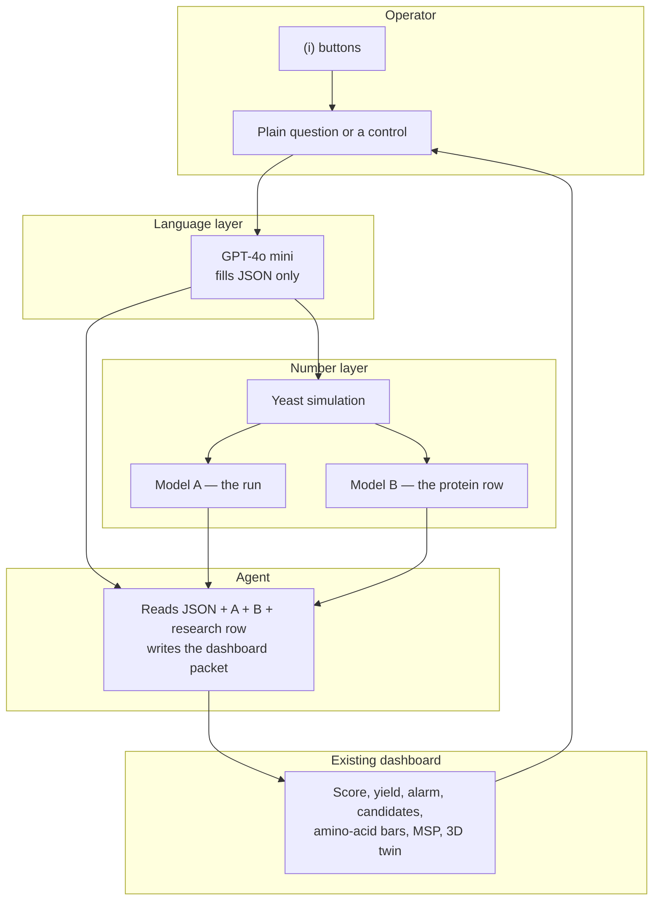
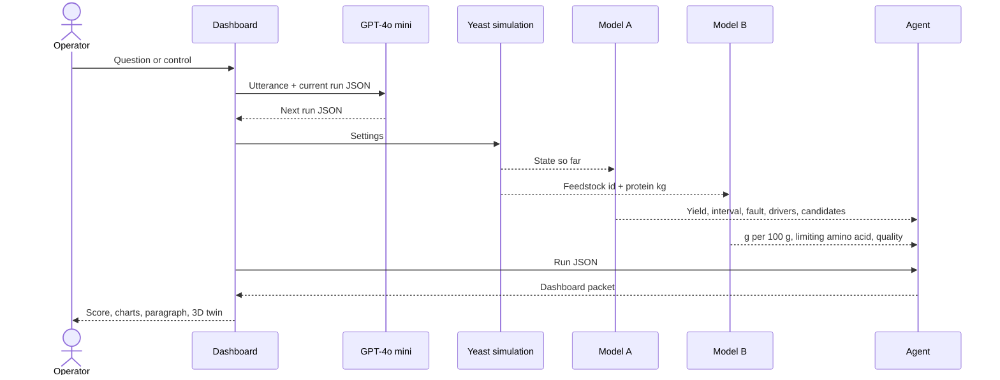
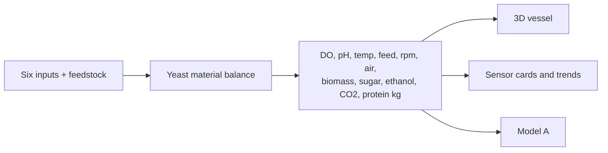

# FermaTwin — Product Requirements Document

| | |
| --- | --- |
| Product | FermaTwin |
| Document | PRD, version 1.0 |
| Angle | (a) Process intelligence, with a plant-protein layer |
| Status | Hackathon build specification |
| Interface | Existing FermaTwin dashboard and 3D vessel |

This document is the build contract. A screen, model, or sentence that is not described here is out of scope for the demo.

---

## 1. Problem statement

Fermentation outcomes depend on many interacting parameters (oxygen, pH, temperature, feed rate, agitation), yet runs are often managed with fixed settings or operator experience. Batches are lost to drift or contamination, and energy is wasted. Separately, substrates picked on price or protein then fail on yield or supply.

Teams choose one of two angles. This product takes angle (a), process intelligence:

A tool that learns from several process parameters during a run (dissolved oxygen, pH, temperature, agitation, aeration, feed rate, biomass, off-gas CO₂) to:

1. Predict final yield early.
2. Catch drift or contamination with few false alarms.
3. Recommend settings that keep yield high while using less energy.
4. Show which parameters drive the result and how they interact.

The substrate sentence in the problem is covered as a second card on the same run: a feedstock chosen for price or headline protein can still lose on yield. That card does not replace the four duties above.

## 2. Product

FermaTwin is one vessel, talked to in plain language, that makes a food yeast protein from a plant sugar.

The operator asks a question or moves a control. GPT-4o mini turns the words into a JSON run card. A yeast simulation advances the tank. Two models score that state. An agent reads the JSON and both model outputs and fills the dashboard. The next question is the next turn, and the score moves.

The ingredient being made is **BR-101 yeast protein**: *Saccharomyces cerevisiae* biomass, dried, grown on glucose, cane molasses, or pea-starch hydrolysate. The protein is the yeast. The crop is the sugar source, not a bag of pea protein that the tank is “improving.”

At any moment the screen answers four questions:

1. How much protein will this batch finish with?
2. Is the run drifting, and which signals say so?
3. Which setting change holds protein up and spends less energy?
4. For this feedstock, what are the amino acids in grams per 100 g of protein, and what is the minimum selling price?



## 3. Who it is for

One operator on one vessel during a demo. They are not a modeller. They ask “pea hydrolysate, less air, score it,” read 0.80, and try the suggested change.

Judges are the second reader. They must be able to see that the numbers came from Model A and Model B, and that the paragraph only restates those numbers.

## 4. What we are not building

- Accounts, billing, multi-plant administration, and extra report suites.
- A claim that dissolved oxygen, pH, or CO₂ measured digestibility or DIAAS.
- A contamination verdict. The product may say a process fault is suspected. It may not say the batch is infected.
- A penicillin product. IndPenSim is an offline proof that the training recipe learns a published fermentation. The demo vessel makes yeast protein.
- A parsed training set from the ABPDU ambr250 export. That zip is a raw 12-vessel log, not a labelled table.
- Fine-tuning of GPT-4o mini.
- The 2,200 Raman wavelength columns in IndPenSim. They stay out of version 1.

## 5. The protein

### 5.1 The ingredient

| Piece | Definition in this product |
| --- | --- |
| Organism | *Saccharomyces cerevisiae*, food yeast |
| Feedstocks | Glucose, cane molasses, pea-starch hydrolysate |
| Nitrogen | Ammonia or yeast extract, expressed as a carbon-to-nitrogen setting |
| Product | Dry yeast protein from that run |
| Useless outcome | Sugar turned into ethanol because air was short |

More dry yeast is not the goal. More protein per kilogram of sugar, at a lower selling price, with the amino-acid pattern of the chosen feedstock row, is the goal.

### 5.2 What “good protein” means here

Four ideas, and only the first two are calculated for the demo. The last two are labels.

| Idea | What the operator is told | Where the number comes from |
| --- | --- | --- |
| Protein concentration | Grams of protein in the dry yeast, and kilograms in the batch | Model A, from biomass and a feedstock protein fraction in the simulation |
| Amino-acid balance | Grams of each essential amino acid per 100 g protein, and which one is limiting | Model B, from a published row for that feedstock. Not from the probes |
| Digestibility | A fixed label: not measured on this batch | Research card |
| DIAAS | Shown only when a published score exists for that ingredient, marked as a reference | Research card |

Yeast protein is described with one fixed sentence on every quality card: food yeast is protein-rich and usually short on sulfur amino acids. That sentence does not change with pH.

### 5.3 Minimum selling price

MSP in this product means the **minimum selling price of the yeast protein**, in rupees per kilogram of protein.

```text
MSP = (feedstock cost + electricity cost) / protein kilograms
```

Electricity is an illustrative function of agitation and aeration. It is labelled as a calculation, not a meter. Feedstock price is an input. It may start from the government support price of the source crop. A run that looks cheap per kilogram of sugar can still have a high MSP if protein kilograms are low.

### 5.4 The score

One number from 0 to 1 on the card. It is the average of two halves, both shown:

- **Run half, from Model A.** Protein per kilogram of sugar, penalised when MSP is high and when the oxygen-risk flag is on.
- **Protein half, from Model B.** How close the limiting amino acid comes to the adult requirement pattern on the research row.

A first turn might read 0.80. After a better setting, both halves are recomputed and the score updates. GPT does not choose 0.80.

## 6. Fit to the problem statement

| Duty in angle (a) | Product behaviour | Done when |
| --- | --- | --- |
| Learn from DO, pH, temperature, agitation, aeration, feed, biomass, off-gas CO₂ during the run | Model A is trained on those signals and scored on partial histories | Prediction at 20%, 40%, 60%, and 80% of the batch uses only rows up to that time |
| Predict final yield early | Model A outputs final protein kilograms and an error bar | On held-out yeast batches it beats “today’s protein is the final protein” and beats “always predict the training-set mean” |
| Catch drift with few false alarms | Model A raises a fault score. A sensitivity slider sets the threshold | Normal held-out batches stay mostly quiet. Fault examples still fire. The copy says contamination is not confirmed |
| Recommend yield and energy together | Two or three candidates, each with protein change and electricity change | The applied candidate is the one the table ranks, not a hardcoded “add air” |
| Show drivers and interactions | Model A importances, plus one interaction: air × sugar feed | The panel lists the drivers from the model. It says “associated with the prediction” |

The feedstock comparison is the extra line in the problem (substrates picked on price or protein can fail on yield). Model B scores two research rows. It is not a substitute for the table above.

## 7. Modes

The dashboard has two named modes. They never share a yield unit.

### 7.1 Yeast run

This is the product. Inputs are the six controls in section 8. Outputs are protein kilograms, ethanol, MSP, the score, amino-acid grams, and the fault flag. The 3D twin, sensor cards, and trends read this simulation.

### 7.2 Benchmark

Replay of a held-out IndPenSim batch. Model A’s training recipe is shown predicting **penicillin**, in the dataset’s units (g/L online, harvested kilograms from the statistics file). Dissolved oxygen is mg/L. Temperature is converted from kelvin for display. Volume stays in the tens of thousands of litres. The header says penicillin. This mode exists so a judge can see learning on a published dataset. It is not the yeast product.

## 8. Inputs

### 8.1 What the operator can set

| Input | Allowed demo values | Effect in the yeast simulation |
| --- | --- | --- |
| Feedstock | Glucose, cane molasses, pea-starch hydrolysate | Sugar price, protein fraction, and which Model B row is legal |
| Sugar feed | Slider inside operating bounds | Carbon into the tank. Past the oxygen supply, extra feed becomes ethanol |
| Air | Slider inside operating bounds | Dissolved oxygen. Low air raises ethanol and cuts protein kilograms |
| Agitation | Slider inside operating bounds | Mixing and electricity |
| Temperature | Slider inside operating bounds | Growth rate |
| pH | Slider inside operating bounds | Growth rate |

Nitrogen source and carbon-to-nitrogen ratio sit under feedstock as one extra control, because they move the protein fraction of the cell. They are not a seventh story.

### 8.2 What the simulation produces each step

Dissolved oxygen, pH, temperature, agitation, aeration, feed rate, biomass, residual sugar, ethanol, off-gas CO₂, protein kilograms so far, electricity so far.

Ethanol is yeast-specific. When oxygen is short, this organism spends sugar on alcohol. That is how a process parameter becomes a protein loss.

### 8.3 Info buttons

Every control and every result has an **(i)** button. The text is fixed. The agent does not rewrite it.

| Control | (i) text |
| --- | --- |
| Feedstock | Sets the sugar, the price, and which published amino-acid row Model B may use |
| Air | Holds dissolved oxygen up. Short air sends sugar into ethanol and cuts protein kilograms |
| Agitation | Mixes the vessel and adds electricity to the selling price |
| Feed rate | Adds sugar. Past the oxygen supply, extra feed becomes ethanol |
| Temperature | Sets how fast the yeast grows |
| pH | Sets how comfortably the yeast grows |
| Score | Protein per kg sugar, amino-acid coverage, and price, pressed into one number from 0 to 1 |
| MSP | Rupees per kg of protein required to cover feedstock and power. Power is calculated, not metered |
| Fault | A process-fault warning. It is not a laboratory confirmation of contamination |
| Amino acids | Grams per 100 g protein from the research row for this feedstock |

## 9. Questions the product accepts

GPT-4o mini classifies each turn as one intent. If the sentence mixes two intents, it keeps the one that changes the run, and the agent mentions the other in a single clause.

| Intent | Examples |
| --- | --- |
| Set feedstock | “Use pea-starch hydrolysate.” “Switch to molasses.” |
| Set run | “Less air.” “Hold 30 °C and pH 5.5.” “Feed harder after hour 6.” |
| Score | “Score this run.” |
| Explain | “What does agitation do to the price?” “Why did the score fall?” |
| Compare | “Which plant gives better protein, pea sugar or molasses?” |
| Quality | “Show amino acids in grams per 100 grams.” “What is limiting?” |
| Price | “What is the MSP?” “Does this beat the crop support price?” |
| Trouble | “Dissolved oxygen is falling. What should I change?” “Is this contamination?” |
| Apply | “Apply the change and rescore.” |

Anything outside this list gets a refusal JSON (`intent: unsupported`) and one sentence that lists the intents above.

## 10. System pipeline



GPT, Model A, and Model B do not call each other. The agent is the only component that sees all three outputs. The agent may not compute a new yield. If a field is missing, the paragraph says it is missing.

## 11. GPT-4o mini contract

Model: a GPT-4o mini class chat model. No fine-tune. Temperature low. Response must be JSON and nothing else.

Input to the model:

- The operator’s latest sentence.
- The current run JSON.
- The intent list from section 9.
- The allowed feedstocks and the operating bounds.

Output schema:

```json
{
  "intent": "set_run",
  "feedstock": "pea-starch-hydrolysate",
  "nitrogen": "ammonia",
  "settings": {
    "sugarFeed": 0.35,
    "aeration": 0.8,
    "agitation": 350,
    "temperatureC": 30,
    "ph": 5.5
  },
  "compareFeedstock": null,
  "applyCandidateId": null,
  "unsupportedReason": null
}
```

Rules in the system prompt:

- Change only fields the sentence names. Leave the rest equal to the current run.
- Do not invent protein kilograms, MSP, scores, or amino-acid grams.
- Do not claim contamination.
- If the sentence is unsupported, set `intent` to `unsupported` and leave settings unchanged.

## 12. Model A — the run

### 12.1 Job

From measurements collected so far, predict final protein kilograms, an uncertainty interval, a fault score, the parameters that moved the prediction, and a short list of setting candidates with protein and energy.

### 12.2 Features

Current value and the change over the last two hours, plus the fraction of the batch elapsed, for:

- Dissolved oxygen
- pH
- Temperature
- Agitation
- Aeration
- Sugar feed rate
- Biomass
- Off-gas CO₂
- Residual sugar
- Ethanol

Feedstock id is a categorical feature. Rows are sampled at 20%, 40%, 60%, and 80% of each training batch. A row at 40% does not contain any later measurement.

### 12.3 Targets

| Target | Definition |
| --- | --- |
| Final protein kilograms | Ending protein of that yeast batch |
| Fault | 1 when the batch was generated as a drift case, else 0 |
| Importances | From the fitted yield model, on held-out batches |
| Candidates | A small grid on aeration and agitation, inside bounds. Each cell is re-scored by the yield model and by the electricity function |

### 12.4 Training and split

Yeast batches are generated by the same simulation the dashboard runs, including normal runs and scripted drift runs (low air, pH drift). Split by batch, never by row.

| Split | Use |
| --- | --- |
| Train | Fit the yield model and fit the fault model on normal batches only |
| Held-out normal | Report yield error and false alarms |
| Held-out drift | Report missed faults |

Baselines, reported next to the model error:

1. Predict the training-set mean final protein.
2. Predict that protein so far is the final protein.

If Model A does not beat both on the held-out normal batches, the card shows that. The loss is not hidden.

The fault threshold is the sensitivity slider. Default is the threshold that keeps false alarms on held-out normal batches low. The slider is part of the demo, so a judge can see the false-alarm versus miss tradeoff.

### 12.5 IndPenSim check

Same recipe, different target, separate weights. Not loaded in the yeast screen.

| Item | Fact |
| --- | --- |
| Source | [IndPenSim on Mendeley](https://data.mendeley.com/datasets/pdnjz7zz5x/2), `100_Batches_IndPenSim_V3.csv` and `100_Batches_IndPenSim_Statistics.csv` |
| Process columns | Time, aeration, agitator rpm, sugar feed, acid flow, base flow, dissolved oxygen, penicillin g/L, volume, pH, temperature, off-gas CO₂, OUR, CER, substrate, fault flag, batch id |
| Ignored | About 2,200 Raman columns |
| Label | Total penicillin harvested, from the statistics file |
| Fault label | Statistics file: batches 91–100 are fault = 1, batches 1–90 are fault = 0 |
| Split | Train on batches 1–70. Yield test on 71–90. Fault test on 91–100 after the detector is calibrated on normal batches |
| Known trap | A fault is not a small harvest. Batch 93 is flagged and has the largest total in the statistics file. Batch 99 is flagged and is among the smallest. The benchmark screen shows both |

Units on that screen stay honest: dissolved oxygen in mg/L, temperature converted from kelvin, vessel volume as recorded.

### 12.6 Candidate recommendations

Each candidate is a full setting vector. The card shows:

| Column | Meaning |
| --- | --- |
| Change | What moved relative to now (air, agitation, or feed) |
| Predicted protein | Model A final protein kilograms |
| Electricity | Illustrative kWh from agitation and aeration |
| Inside bounds | Yes or no. Out-of-bound candidates are not selectable |
| Uncertainty | The same interval method as the live prediction |

The rank is: higher predicted protein, then lower electricity, dropping any candidate outside bounds. The agent’s “apply” sentence names the top row’s id. Applying it writes those settings into the simulation. The next steps show dissolved oxygen, ethanol, and the score respond.

A candidate that only increases air and electricity is allowed to appear. It is not allowed to be described as the energy-saving choice unless its electricity is lower.

### 12.7 Drivers and interactions

The explain panel lists the top Model A importances for the current timepoint. Beside that, one interaction is always available: predicted protein against air and sugar feed, from the candidate grid. Copy says these are associations in the model, not a cause proven on a plant.

## 13. Model B — the protein row

### 13.1 Job

Answer “what protein is this, in grams per 100 g, and which feedstock row is better?” It does not predict yield.

### 13.2 Inputs

- Feedstock id from the run JSON.
- Protein kilograms from Model A, used only to scale batch mass. The grams per 100 g pattern comes from the row, not from kilograms.
- Optional second feedstock id when the intent is `compare`.

### 13.3 The research table

A small checked-in table, one row per feedstock. Columns are the essential amino acids in grams per 100 g protein, the limiting amino acid, a literature source line, and a protein fraction used by the simulation. Values are copied from published food-composition sources and stored with the citation. They are not fitted to IndPenSim and not fitted to dissolved oxygen.

If a feedstock has no row, Model B returns `available: false`. The agent says the amino-acid pattern is not on file. It does not estimate one.

### 13.4 Outputs

| Field | Meaning |
| --- | --- |
| `gramsPer100g` | The row, ready for a bar chart |
| `limitingAminoAcid` | The essential amino acid furthest under the adult requirement pattern |
| `coverage` | Limiting amino acid divided by its requirement, capped for display, from 0 to 1 |
| `quality` | Equal to coverage in version 1 |
| `comparison` | Present only for `compare`: both coverages and which feedstock is higher |

Pea sugar versus molasses is two row lookups. The higher coverage wins on quality. Model A still decides which one makes more protein kilograms and which one has the lower MSP. The agent must say both, because a better amino-acid pattern can be the worse factory result.

### 13.5 Why this is a second model

Model A can rank runs of the same feedstock. It cannot say that molasses-grown yeast and pea-hydrolysate yeast have different amino-acid patterns, because those patterns are not in the probe stream. Model B is that lookup, with a numeric coverage so the score’s protein half is stable. A later version may regress coverage from matched assays. Version 1 does not, because neither downloaded dataset contains amino-acid labels.

## 14. Agent

The agent is one GPT-4o mini call after the models, or a fixed template if the API is down. The demo must still finish on the template.

Input packet:

```json
{
  "run": {},
  "modelA": {
    "predictedProteinKg": 0,
    "interval": [0, 0],
    "faultScore": 0,
    "fault": false,
    "drivers": [],
    "candidates": []
  },
  "modelB": {
    "available": true,
    "gramsPer100g": {},
    "limitingAminoAcid": "",
    "quality": 0,
    "comparison": null
  },
  "score": { "value": 0, "runHalf": 0, "proteinHalf": 0 },
  "mspInrPerKg": 0
}
```

Duties:

1. State predicted protein, the interval, and the score.
2. If `fault` is true, name the signals in `drivers` or the fault evidence and say contamination is not confirmed.
3. Describe the top candidate’s protein change and electricity change.
4. If Model B is available, state the limiting amino acid and that the grams per 100 g are from the research row.
5. Refuse any number that is not in the packet.

The agent does not browse, does not call the simulation, and does not change settings. `apply` is a UI action that writes `applyCandidateId` into the run.

## 15. Simulation

One shared state drives the 3D twin, the sensor cards, the trends, Model A’s features, and the agent packet.



Scripted disturbances, chosen by the operator or by the question “less air”:

| Disturbance | What the state does |
| --- | --- |
| Low air | Dissolved oxygen falls, ethanol rises, protein rate falls, MSP rises |
| pH drift | pH leaves the setpoint, growth slows |
| Stable | Signals stay near setpoints |

The disturbance is labelled on screen as a simulation. Replay of an IndPenSim batch does not run this yeast balance. It plays recorded rows.

Operating bounds are the same bounds the sliders and the candidate grid use. A recommendation outside them is shown and disabled.

## 16. Dashboard

The current FermaTwin shell stays. No new product area.

| Place | Content |
| --- | --- |
| Ask box | The sentence, plus the last JSON intent in small type so a judge can see the parse |
| Overview | Mode switch, sensors, 3D twin, score, early protein prediction, MSP |
| (i) buttons | Section 8.3, on each control and on score, MSP, fault, and amino acids |
| Alarms | Fault score, evidence, sensitivity slider, false-alarm note from the held-out normal set |
| Insights | Drivers, air × feed grid, amino-acid bars, Model B comparison, agent paragraph |
| Candidates | The Model A table. Apply writes settings and rescores |
| Benchmark mode | IndPenSim replay, penicillin units, batches 93 and 99 available as examples |

The 3D vessel remains the glass fermenter: motor, coloured probes, impeller, sparger, broth, dissect, and callouts bound to those parts. Callouts read the yeast state in yeast mode and the recorded row in benchmark mode.

### 16.1 Copy that must appear

- “Predicted from the run model.”
- “Amino acids from the research row for this feedstock, not from the probes.”
- “Electricity is calculated from agitation and air, not from a meter.”
- “Process fault suspected. Contamination is not confirmed.”
- In benchmark mode: “Penicillin, IndPenSim. This is not the yeast protein run.”

## 17. Demo script

One sitting, about five minutes.

1. Yeast mode. Ask “Pea-starch hydrolysate, score it.” Show the JSON, the early protein kilograms, the interval, the score, the amino-acid bars, and the MSP.
2. Ask “Less air,” or cut aeration. Dissolved oxygen falls on the cards and in the twin. Ethanol rises. The fault flag fires. The paragraph names the signals and says contamination is not confirmed.
3. Open candidates. Show at least one option with more predicted protein and one comparison of electricity. Apply the top in-bound row.
4. Let the simulation answer. Dissolved oxygen and the score update. The second score is the point of the demo.
5. Ask “Compare with molasses.” Model B shows both grams-per-100 g patterns and which limiting amino acid is covered better. Model A’s protein kilograms and MSP stay visible so yield and pattern are not collapsed into one adjective.
6. Switch to benchmark. Replay a normal held-out batch and show the penicillin prediction tightening over time. Then open batch 93 and batch 99 and say a fault flag and a bad harvest are different facts.

## 18. Data

| Dataset | Role in version 1 |
| --- | --- |
| Generated yeast batches | Train and test Model A for the product |
| [IndPenSim](https://data.mendeley.com/datasets/pdnjz7zz5x/2) | Benchmark mode and the published-data proof |
| Research amino-acid rows | Model B. Citations stored with the table |
| [ABPDU FCIC ambr250 export](http://abpdu.lbl.gov/resources/fermentation-bioreactor-sample-data/) | Not in the demo. A later experimental check only |

IndPenSim process fields used if the benchmark model is trained: time, aeration rate, agitator rpm, sugar feed rate, acid flow, base flow, dissolved oxygen, pH, temperature, off-gas CO₂, OUR, CER, substrate, volume, penicillin concentration, fault flag, batch id. Final penicillin comes from the statistics file, joined on batch id.

## 19. Acceptance

The build is acceptable when all of these are true in one session:

1. A plain-language turn changes only the JSON fields the sentence named.
2. Protein kilograms at mid-run differ from protein kilograms at the start, and the held-out error beats both baselines.
3. Cutting air raises the fault flag, moves dissolved oxygen and ethanol, and the sensitivity slider can quiet a normal run.
4. The fault sentence says contamination is not confirmed.
5. The candidate table shows protein and electricity, and Apply changes the live yeast state.
6. Drivers list comes from Model A. The air × feed grid is on screen.
7. Amino-acid bars match the research row for the selected feedstock, including on a compare turn.
8. The score’s two halves are visible, and the second turn’s score is recomputed, not typed.
9. Benchmark mode is labelled penicillin and can show batch 93 beside batch 99.
10. With the language API disabled, the template packet still fills the dashboard.

## 20. Risks

| Risk | What we do |
| --- | --- |
| The paragraph invents a yield or a contamination | Agent input is the packet only. Template fallback has no free text |
| Judges treat IndPenSim as plant-protein data | Separate mode, separate units, sentence in section 16.1 |
| Amino-acid bars are read as a live assay | (i) button and the research-row sentence |
| “More air” is recommended as if it saved energy | Rank uses electricity. Copy must match the table |
| Only ten IndPenSim fault batches | Detector is calibrated on normal batches and tested on 91–100. It is not a contamination classifier |
| MSP is read as a quote | Label it calculated from feedstock price and the power function |
| GPT returns prose instead of JSON | Reject the turn and keep the previous run |

## 21. Build order

1. Yeast simulation state on the existing dashboard, with the six inputs and ethanol.
2. Model A training, baselines, fault threshold, candidate grid.
3. Research table and Model B.
4. Score from the two halves, MSP, (i) buttons.
5. GPT JSON turn and the agent packet, with template fallback.
6. IndPenSim benchmark replay for one normal batch, batch 93, and batch 99.
7. Rehearse section 17 from a cold browser session.

## 22. References

- Problem angle (a), as quoted in section 1.
- IndPenSim: [Mendeley Data, pdnjz7zz5x, version 2](https://data.mendeley.com/datasets/pdnjz7zz5x/2). Goldrick et al., industrial-scale penicillin fermentation simulation.
- ABPDU sample fermentation data, not used in version 1: [Berkeley Lab ABPDU](http://abpdu.lbl.gov/resources/fermentation-bioreactor-sample-data/).
- [FermPilot](https://www.fermpilot.com/). Beer kinetics: few inputs, a trajectory, a decision time. The interaction pattern, not the organism.
- NutriOpt, amino-acid blending for plant foods: [Frontiers in Nutrition, 2022](https://pmc.ncbi.nlm.nih.gov/articles/PMC9128549/).
- HealthFerm, fermentation conditions linked to amino acids and digestibility in faba bean and oat: project deliverable D2.2.
- [ProteinProcessIO](https://proteinprocess.io/). Dry fractionation twin for pulses. A different unit operation.
